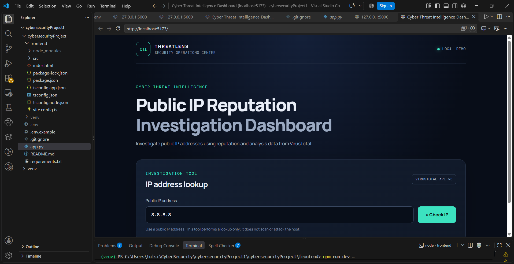
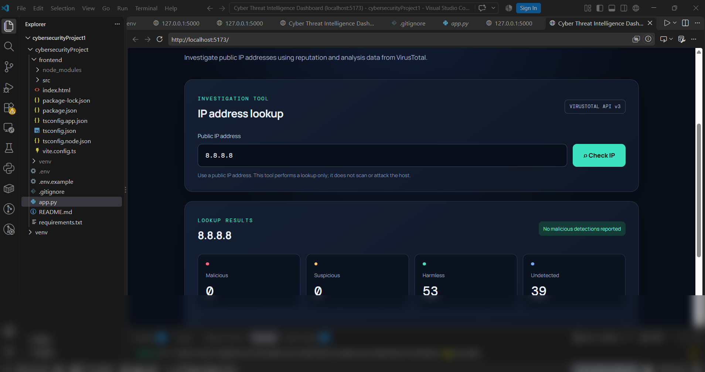
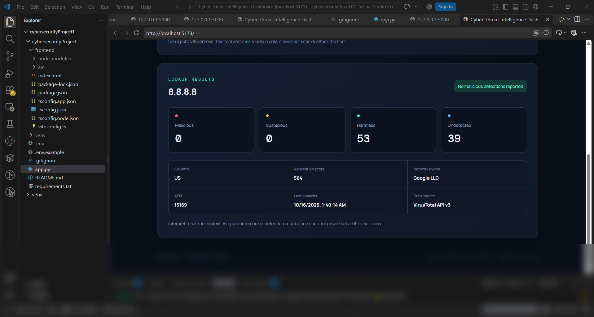

🛡️ Cyber Threat Intelligence Dashboard — ThreatLens

A full-stack cybersecurity project for looking up public IP address reputation using the VirusTotal API. The application combines a React + TypeScript frontend with a Flask backend to help users review threat intelligence indicators.

📸 Screenshots

## Screenshots

### Dashboard Home

### IP Lookup Results

### IP Reputation Details

✨ Features

Look up public IP address reputation using VirusTotal API v3.

Review available malicious and suspicious detection information.

Use a React and TypeScript frontend.

Process API requests through a Flask backend.

Configure the API key using environment variables.

Handle common lookup errors and API quota limitations.

🧰 Tech Stack

Technology

Purpose

Python

Backend programming

Flask

Backend API

React

User interface

TypeScript

Frontend development

Vite

Frontend development server

VirusTotal API v3

IP reputation intelligence

⚙️ Requirements

Python 3.10 or newer

Node.js 20.19+ or 22.12+

A VirusTotal API key

🚀 Run Locally

1. Clone the repository

git clone https://github.com/tulsidounekarr/cyber-threat-intelligence-dashboard.git
cd cyber-threat-intelligence-dashboard

2. Configure the environment

Create a .env file in the project root, next to app.py, using .env.example as a template.

Add your own API key:

VIRUSTOTAL_API_KEY=your_real_api_key

Security: Never commit your real .env file or expose your API key in frontend code.

3. Install and run the backend

Open a PowerShell terminal in the project root:

python -m venv venv
.\venv\Scripts\Activate.ps1
pip install -r requirements.txt
python app.py

Backend health check:

http://127.0.0.1:5000/api/health

4. Install and run the frontend

Open a second terminal:

cd frontend
npm install
npm run dev

Open the local URL printed in your terminal, usually http://localhost:5173.

Keep both backend and frontend terminals running.

🔧 Troubleshooting

Failed to fetch: Check that Flask and Vite are both running.

API key not configured: Check the root .env file and variable name.

401 response: Verify your API key.

429 response: You may have reached the provider's API quota.

No report available: VirusTotal may not have a report for the queried IP.

🔐 Scope and Responsible Use

This project is intended for defensive threat intelligence and educational use. It retrieves publicly available IP reputation information; it does not scan ports, exploit systems, or attack IP addresses.

Reputation results are indicators, not proof of malicious activity. The Flask development server is intended for local use rather than public production deployment.

👨‍💻 Author
Tulsi Dounekar
Tulsi Dounekar

View Project Repository
